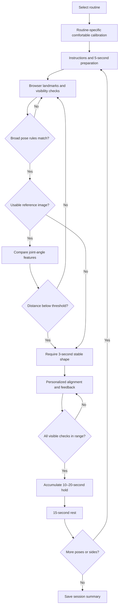

## III. METHODOLOGY

### A. System Overview
The platform provides six routines containing 13 asanas. NCERT instructions [1] define pose variants, alignment rules, and whether left/right holds are performed separately. Account-based profiles store comfortable movement measurements and session summaries. Camera frames and landmark inference remain in the browser; the Node.js/SQLite backend stores no video.



*Fig. 1. Routine workflow. Lost tracking or persistent shape mismatch returns to recognition. Hold time pauses outside the accepted range.*

### B. Landmark Acquisition and Geometry
MediaPipe Pose Landmarker [2] supplies 33 landmarks. Required landmarks must have visibility and available presence scores at least 0.6 and remain inside the image. The prescribed front or side view is checked; unreliable frames are not scored. Normalized coordinates are converted to pixels, \(P_i=(Wx_i,Hy_i)\), to correct the aspect ratio. For joint vertex \(B\), let \(u=A-B\) and \(v=C-B\):

\[
\theta_{ABC}=\frac{180}{\pi}\cos^{-1}\left(\frac{u\cdot v}{\|u\|\|v\|}\right). \tag{1}
\]

The cosine input is clipped to \([-1,1]\); zero-length segments are rejected. Shoulder, elbow, hip, and knee angles use the corresponding three landmarks. Segment elevation is \(\alpha=\frac{180}{\pi}\operatorname{atan2}(|\Delta y|,|\Delta x|)\), assuming a level camera.

### C. Routine-Specific Personalization
Only movements relevant to the selected routine are calibrated, separately on each side. A comfortable 3-second hold provides at least 20 samples. Angular samples are accepted when \(Q_{0.90}-Q_{0.10}\leq14^\circ\). A comfortable measurement is estimated as

\[
C_j=\operatorname{round}(Q_p(S_j)),\qquad p\in\{0.25,0.75\}. \tag{2}
\]

The upper percentile represents increasing reach; the lower represents deeper folding. For increasing excursion, \(T_j=\min(C_j,I_j)\). For a supine leg raise, \(T_{\mathrm{hip}}=180^\circ-\min(C_{\mathrm{leg}},I_{\mathrm{leg}})\); fixed positioning checks retain textbook targets. Skipped or expired checks exclude dependent holds. These measurements estimate task-specific reach, not clinical ROM.

### D. Pose Recognition Before Evaluation
Broad rules test body orientation, limb arrangement, and relative hand/foot locations before precise alignment is scored. Scale-independent relations use \(\rho_{ab}=\|P_a-P_b\|/\|P_s-P_h\|\), where \(s\) and \(h\) denote shoulder and hip. Compatible reference images are processed using the same landmarker. For four visible joint-angle features, reference discrepancy is

\[
D=\frac{1}{4\times180^\circ}\sum_{j=1}^{4}|\theta_j-\theta_j^{\mathrm{ref}}|. \tag{3}
\]

Recognition requires the broad rules and, when a usable reference exists, \(D<0.48\). The candidate must remain stable for 3 seconds, with angular drift below \(14^\circ\) from its current stability anchor. Incompatible or low-confidence references use rules alone. This interpretable prototype avoids training KNN from one image per pose; recognition tolerates incomplete mobility.

### E. Alignment and Multimodal Feedback
For numeric ideal \(I_j\), personalized target \(T_j\), and observed angle \(\theta_j\), the acceptable interval is

\[
[\min(T_j,I_j)-\tau_j,\;\max(T_j,I_j)+\tau_j]. \tag{4}
\]

Tolerances are \(8^\circ\) for joint/elevation checks, \(10^\circ\) for torso proxies, and \(20^\circ\) for inter-arm alignment. Where the textbook specifies no angle, individual excursion or relational rules replace a fabricated ideal. The first failed check produces one directional text cue; browser speech gives instructions and corrections with a 7-second cooldown and duplicate suppression.

```text
 A ●                       target T              ideal I
    \                          |====================|
     \ θ                  -----|--------------------|-----
      ● B─────● C             -τ                   +τ

(a) Joint angle at B      (b) Target-to-ideal acceptance interval
```

*Fig. 2. Three-landmark joint geometry and a target-to-ideal interval; either endpoint may be numerically larger. The PDF contains the publication-ready vector diagram.*

### F. Session Control and Scope
The in-range hold timer advances only while valid visibility \(V\), recognized shape \(R\), and all applicable alignment checks \(E\) hold (binary indicators):

\[
H(t+\Delta t)=H(t)+\Delta t\,V(t)R(t)E(t). \tag{5}
\]

After a 10–20-second hold, the system schedules 15 seconds of rest and 5 seconds of preparation before the next pose/side. Persistent tracking loss or shape mismatch returns to recognition. Summaries record completed holds and tracked/in-range time. Thresholds are provisional: side views assess visible limbs only, and 2D landmarks cannot establish spinal/cervical ROM, comfort, relaxation, or all floor-contact conditions. Recognition accuracy requires empirical validation.

### REFERENCES
[1] NCERT, *Yoga: A Healthy Way of Living, Upper Primary Stage*, 1st ed. New Delhi, India: NCERT, 2015.

[2] Google AI Edge, “Pose landmark detection guide for Web,” developer documentation. [Online]. Available: https://developers.google.com/edge/mediapipe/solutions/vision/pose_landmarker/web_js
